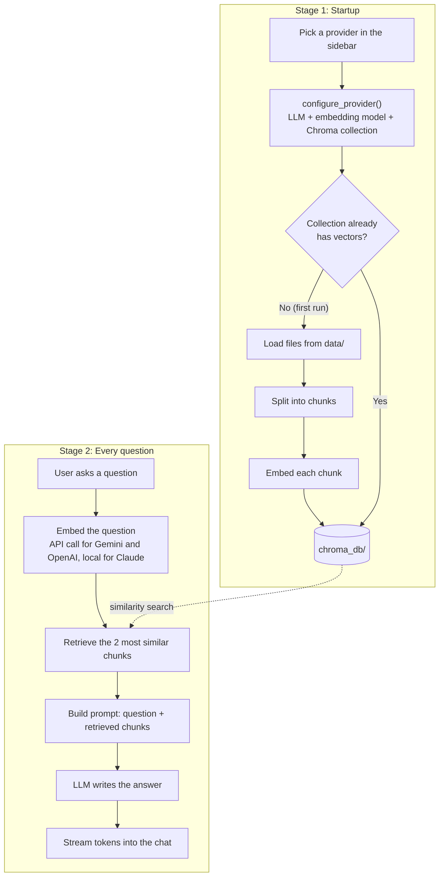

# DocuMind: Multi-Provider Local RAG Assistant

DocuMind is an end-to-end Retrieval-Augmented Generation (RAG) system built with **LlamaIndex**, **ChromaDB**, and **Streamlit**. It enables users to index and chat with local unstructured documents (PDFs, text files) with support for switching dynamically between **Google Gemini**, **OpenAI** and **Anthropic Claude**.

---

## Key Features

- **Multi-Provider LLM & Embedding Support:** Switch dynamically between Google Gemini (`gemini-3.6-flash` / `gemini-embedding-2-preview`), OpenAI (`gpt-4o-mini` / `text-embedding-3-small`) and Anthropic Claude (`claude-opus-5-5` / local `BAAI/bge-small-en-v1.5` embeddings) directly from the sidebar.
- **Streaming Answers:** Responses appear token by token as they are generated.
- **Isolated Vector Collections:** Employs dedicated ChromaDB collections (`documind_gemini`, `documind_openai` and `documind_claude`) to handle different embedding vector dimensions without collisions or indexing errors.
- **Local-First & Zero-Config:** In-process vector storage via ChromaDB requires no external database servers or cloud cluster setups.
- **Interactive Chat Interface:** Clean chat interface built with Streamlit.

---

## Tech Stack & Architecture

| Layer | Technology | Rationale |
| :--- | :--- | :--- |
| **Language** | Python 3.10+ | Industry standard for AI engineering and rapid prototyping. |
| **Orchestration** | LlamaIndex | Handles document ingestion, chunking, and similarity retrieval cleanly without boilerplate. |
| **Vector Store** | ChromaDB (Local) | Embedded vector store running locally in-process; keeps data private and repository clone-and-run friendly. |
| **LLMs & Embeddings** | Google Gemini, OpenAI & Anthropic Claude | Provides flexibility between Google AI Studio's free tier, OpenAI and Claude models. |
| **Local Embeddings** | FastEmbed | Embeds documents and questions on-device for the Claude provider, since Anthropic has no embeddings API. |
| **UI Framework** | Streamlit | Lightweight Python-native framework for real-time chat interfaces. |

---

## How It Works

DocuMind works in two stages. On startup it builds (or reuses) a vector index of your documents for the selected provider; this runs once per provider and is then cached. Then, for every question, it finds the most relevant chunks and asks the LLM to answer from them.



| Provider | LLM | Embeddings | Chroma collection |
| :--- | :--- | :--- | :--- |
| Google Gemini | `gemini-3.6-flash` (thinking level: low) | `gemini-embedding-2-preview` (API) | `documind_gemini` |
| OpenAI | `gpt-4o-mini` | `text-embedding-3-small` (API) | `documind_openai` |
| Anthropic Claude | `claude-opus-5-5` (effort: low, server-side refusal fallback) | `BAAI/bge-small-en-v1.5` (local, via FastEmbed) | `documind_claude` |

Each provider gets its own collection because each embedding model produces vectors of a different size. Response time is dominated by the two network calls in stage 2: embedding the question and generating the answer. The Claude provider embeds locally, so it only makes the second one.

---

## Project Structure

```text
documind/
├── data/                  # Source documents (.txt, .pdf)
├── src/
│   ├── __init__.py
│   ├── pipeline.py        # Multi-provider ingestion, embedding, and query logic
│   └── claude_llm.py      # LlamaIndex LLM that calls Claude via the Anthropic SDK
├── app.py                 # Streamlit multi-provider chat UI
├── .env.example           # Template for environment variables
├── .gitignore             # Git exclusion rules
├── requirements.txt       # Project dependencies
└── README.md              # Project documentation
```

---

## Getting Started

### 1. Clone the Repository
```bash
git clone https://github.com/<your-username>/documind.git
cd documind
```

### 2. Set Up Virtual Environment

**Windows (Command Prompt):**
```cmd
python -m venv venv
venv\Scripts\activate.bat
```

**Windows (PowerShell):**
```powershell
python -m venv venv
venv\Scripts\Activate.ps1
```

**macOS / Linux:**
```bash
python3 -m venv venv
source venv/bin/activate
```

### 3. Install Dependencies
```bash
pip install -r requirements.txt
```

### 4. Configure API Keys
Copy `.env.example` to create your local `.env` file:

**Windows:**
```cmd
copy .env.example .env
```

**macOS / Linux:**
```bash
cp .env.example .env
```

Open `.env` and add a key for each provider you plan to use:
```env
GOOGLE_API_KEY=AIzaSy...your_gemini_key_here
OPENAI_API_KEY=sk-proj-...your_openai_key_here
ANTHROPIC_API_KEY=sk-ant-...your_anthropic_key_here
```

The first time you use the Claude provider, the local embedding model (~70 MB) is downloaded into `.fastembed_cache/`.

### 5. Add Source Documents
Place any `.txt` or `.pdf` files you wish to index inside the `data/` directory.

The index is built on first run and reused afterwards. If you add or change documents later, delete the `chroma_db/` folder so the index is rebuilt.

### 6. Run the Application
Start the Streamlit web interface:
```bash
streamlit run app.py
```
Open your browser at `http://localhost:8501`, pick your desired provider from the sidebar, and begin querying your documents!

---

## License
MIT License. Feel free to use and modify for personal or commercial projects.
